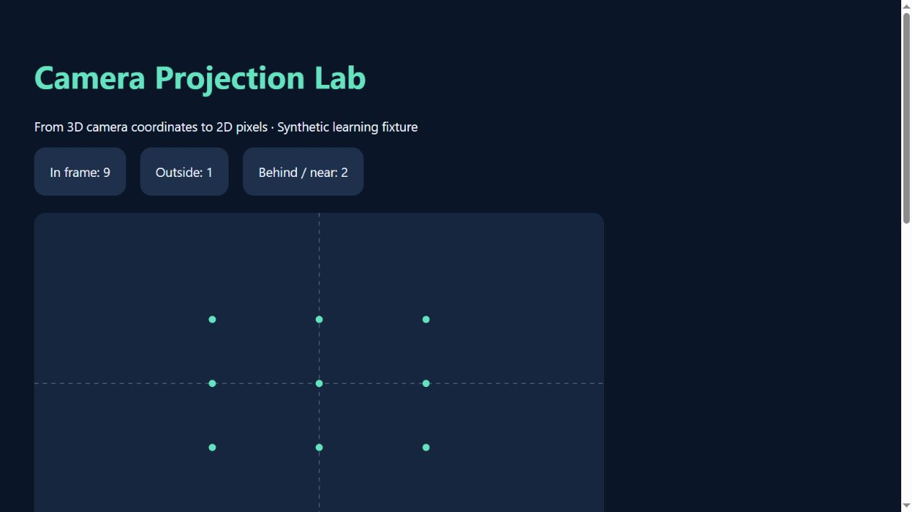
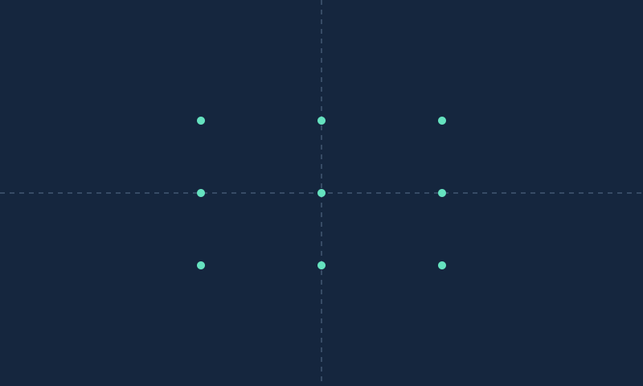

# Camera Projection Lab



Dependency-free Python computer-vision geometry learning lab: project camera-frame 3D points into a distortion-free image plane and export an offline report. Original synthetic scene; no camera hardware or dataset required.



## Status

October 5, 2026: 10 unit tests passed; sample CLI executed. Twelve synthetic points produced nine in-frame projections, one outside-frame point and two behind/near-plane exclusions. These are deterministic fixture outcomes, not accuracy benchmarks or real robot results. Original code, AI-assisted.

## Setup and workflow

Python 3.10+; standard library only, no packages to install.

```sh
python -m unittest -v
python projection.py scene.json --output my-report
```

Open `my-report/index.html`; inspect projected points and classification, download full CSV/JSON. The repository's bundled `index.html` and `projection.svg` are the actual synthetic example outputs. Change `scene.json` camera intrinsics or point depths and generate a **new output directory**. Existing output directories are refused; input files are never modified. Report artifacts are staged before publication to their output directory. CLI errors return exit code 2 with a sanitized message.

## Input and coordinate convention

JSON has `camera` with positive `fx`, `fy`, finite `cx`, `cy`, integer `width`, `height` (1–8192), plus `points`: 1–10,000 three-number lists. File size is capped at 2 MB by the CLI; finite values only, boolean coordinates rejected.

All input points already use the **camera frame**: X right, Y down, Z forward. Z is optical-axis depth, not radial distance. The model uses `u = fx X/Z + cx`, `v = fy Y/Z + cy`. Positive depths greater than 1e-6 are projected; nonpositive/near-plane depths are excluded. In-frame bounds are `0 <= u < width`, `0 <= v < height`. Points outside bounds retain their mathematical pixel coordinates in CSV/JSON but are not drawn. Principal-point axes are dashed. Rendering is a computed diagram, not a photograph.

`backproject(u,v,z,camera)` implements the inverse using supplied positive depth. A single image pixel alone does **not** provide depth. Input units must be consistent; the demonstration treats XYZ as arbitrary consistent length units.

## Architecture

- `projection.py`: camera validation, projection and depth-assisted backprojection, report export, CLI.
- `test_projection.py`: principal point, depth scaling, frame edges, near/behind-plane exclusions, roundtrip, invalid coordinates/intrinsics/depth, empty scene, export/refusal.
- `scene.json`: original synthetic fixture, no external data.
- `results.json`, `points.csv`, `projection.svg`, `index.html`: reproducible sample outputs.

HTML shows the first 100 point rows; JSON/CSV preserve all. SVG draws in-frame points without occlusion filtering. Nonfinite calculated values are rejected. Floating-point arithmetic and formatting affect displayed precision.

## Limitations and research direction

No world-to-camera transforms, calibration estimation, lens distortion, skew, image acquisition, pose estimation, depth estimation, occlusion reasoning, SLAM or robot control. “In frame” is not “visible”—an object could occlude a projected point. This bounded geometry demonstration supports learning toward robot perception, not a claim of robotics expertise. Test with calibrated real data and suitable models before any applied use; never deploy this as a safety system.

## Sources and license

Pinhole equations and camera-coordinate convention checked against [OpenCV's official camera calibration documentation](https://docs.opencv.org/4.13.0/d9/d0c/group__calib3d.html). The implementation is pure Python and does not call OpenCV. Original source and synthetic fixture under MIT; no pretrained models or external dataset. No commercial or academic research results claimed.
